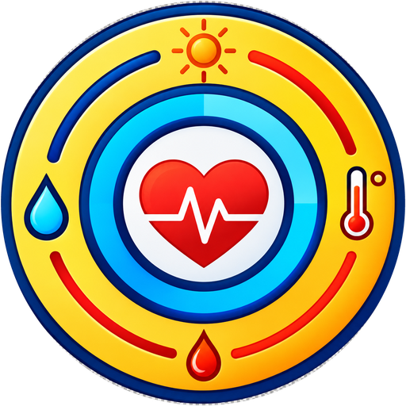
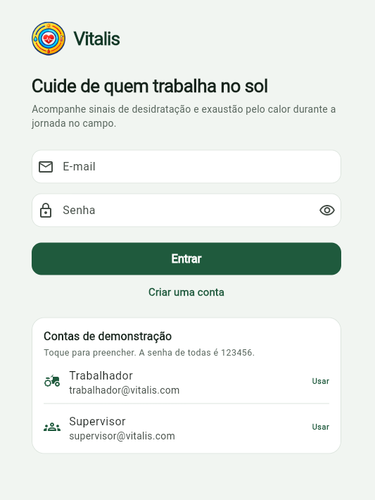
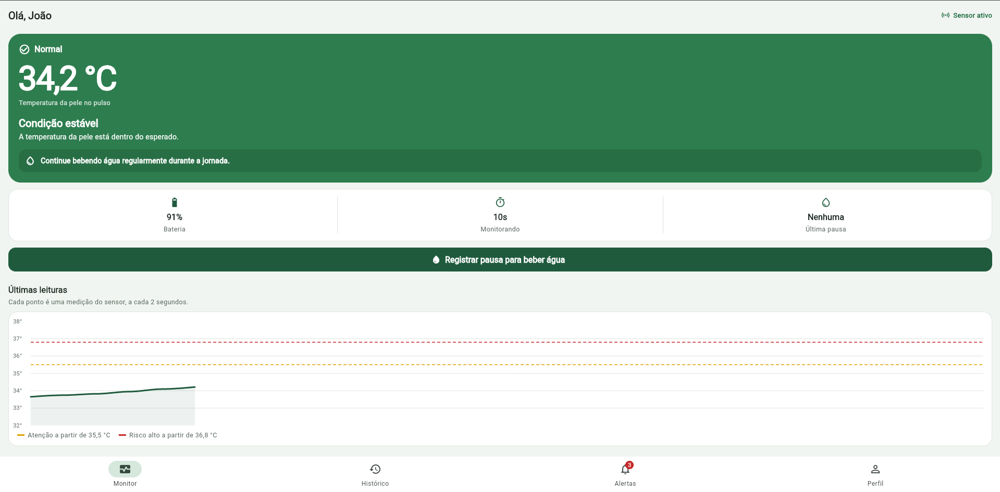
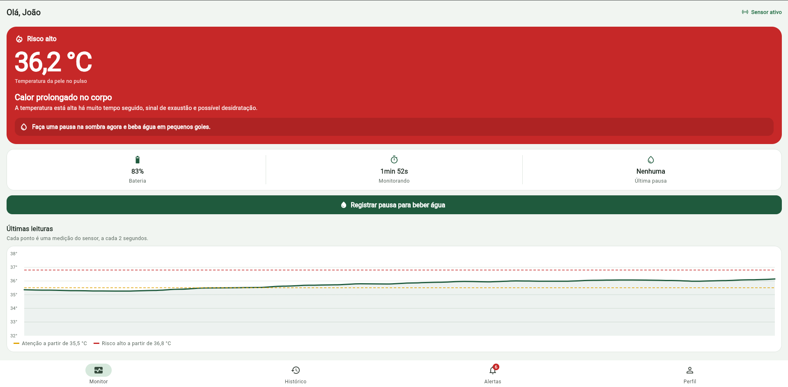
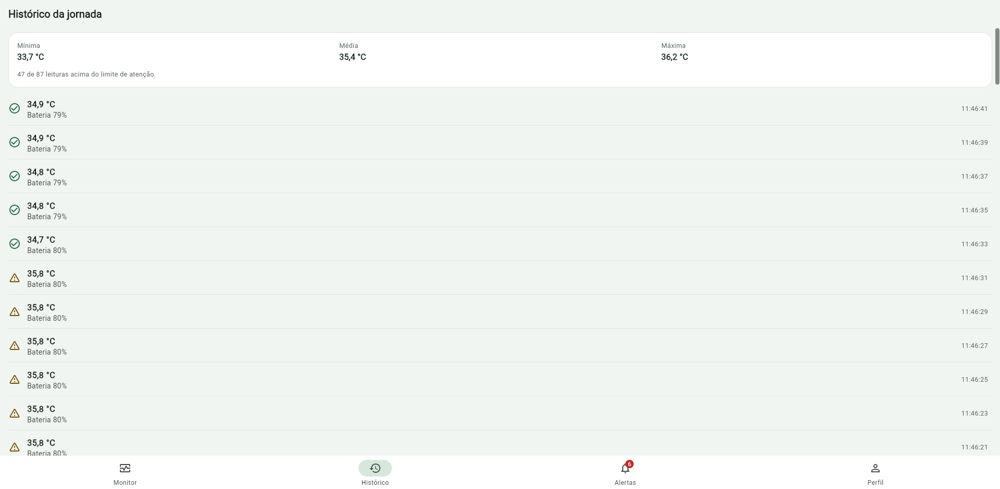
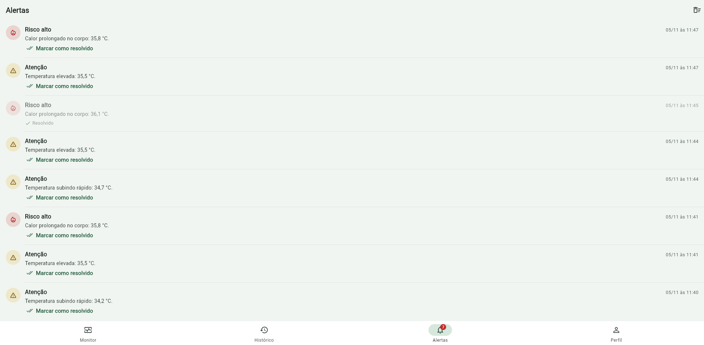
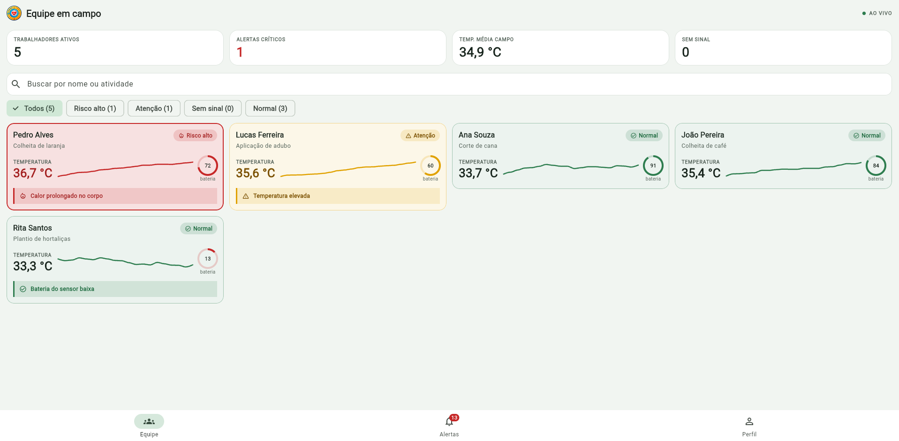

<p align="center">
  
</p>

# Vitalis

**Monitoramento de desidratação e exaustão pelo calor para o trabalhador rural.**

O Vitalis é um aplicativo Flutter que acompanha a temperatura da pele na parte interna do pulso, medida por um biossensor (ESP32 + DS18B20), e avisa o trabalhador e o supervisor quando aparecem sinais de desidratação ou exaustão térmica durante a jornada no campo.

Projeto acadêmico do curso de Engenharia de Software da Universidade de Mogi das Cruzes (UMC), orientado pelas Prof.as Alessandra Martins e Silvia Martini.

## Problema e solução

Quem trabalha na lavoura passa horas exposto ao sol e ao esforço físico. A desidratação e a exaustão pelo calor costumam ser percebidas tarde, quando o trabalhador já está passando mal.

O Vitalis transforma as leituras do sensor em uma orientação simples: mostra a situação atual (normal, atenção ou risco alto), diz o que fazer e registra alertas para o trabalhador e para o supervisor da equipe. O projeto está alinhado às ODS 3 (Saúde e Bem-Estar) e 8 (Trabalho Decente e Crescimento Econômico).

## Funcionalidades

**Trabalhador rural**

- Monitoramento em tempo real da temperatura da pele, com a situação de risco e a recomendação do que fazer.
- Indicadores de bateria do sensor, tempo de monitoramento e última pausa para hidratação.
- Gráfico das últimas leituras com as linhas dos limites de atenção e de risco alto (FL Chart).
- Botão para registrar uma pausa para beber água.
- Histórico da jornada com temperatura mínima, média e máxima.
- Alertas de atenção, risco alto, bateria baixa e sensor sem sinal, com opção de marcar como resolvido.
- Simulador do sensor no Perfil, para demonstrar o app sem o hardware.

**Supervisor**

- Visão da equipe em campo em cartões coloridos pela situação (verde, amarelo, vermelho e cinza), com quem está em risco no topo, resumo da equipe e minigráfico de temperatura em cada trabalhador.
- Painel lateral (telas largas) com o status atual e as ações recomendadas, como acionar socorro e retirar do campo.
- Busca por nome ou atividade e filtros por situação (risco alto, atenção, sem sinal, normal).
- Detalhe de cada trabalhador com o mesmo painel do trabalhador e os alertas recentes.
- Central de alertas de toda a equipe.

**Geral**

- Cadastro e login com perfis de trabalhador e supervisor.
- Sessão, contas e histórico de alertas salvos no aparelho.
- Estados de carregamento, erro e lista vazia em todas as telas.

## Como a análise de risco funciona

As regras ficam em `lib/logic/risk_analyzer.dart` e os limites em `lib/core/constants/risk_thresholds.dart`.

| Situação | Regra | O que o app orienta |
| --- | --- | --- |
| Risco alto | Temperatura da pele a partir de 36,8 °C | Parar, ir para a sombra, beber água e avisar o responsável |
| Risco alto | 15 leituras seguidas a partir de 35,5 °C (calor prolongado) | Pausa na sombra e hidratação |
| Atenção | Temperatura a partir de 35,5 °C | Diminuir o ritmo e beber água |
| Atenção | Alta de 0,8 °C ou mais nas últimas 10 leituras (aquecimento rápido) | Procurar sombra e manter a hidratação |
| Normal | Nenhuma das regras acima | Continuar a hidratação regular |

Um alerta é criado sempre que a situação piora (por exemplo, de normal para atenção). Também há alertas de bateria baixa (15% ou menos) e de sensor sem sinal.

> Os limites são ilustrativos, definidos para fins acadêmicos. O Vitalis é um protótipo e não substitui avaliação médica.

## Simulador do sensor

O protótipo físico (ESP32 + DS18B20) ainda está no backlog do projeto, então o app gera as leituras com um sensor simulado (`lib/data/services/simulated_sensor.dart`). A cada 2 segundos a temperatura se aproxima da temperatura-alvo do cenário de calor escolhido, com uma pequena variação aleatória, e a bateria descarrega um pouco.

| Cenário | Comportamento |
| --- | --- |
| Clima ameno | Temperatura estável, sem alertas |
| Sol forte | Aquecimento gradual até atenção e, depois, risco alto por calor prolongado |
| Calor extremo | Aquecimento rápido até o risco alto |

O trabalhador troca o cenário e simula a perda de sinal na aba **Perfil**. Na equipe do supervisor, cada trabalhador recebe um cenário diferente, e um deles começa com a bateria quase no fim, para mostrar os alertas de bateria baixa e de sensor sem sinal.

Quando o hardware estiver pronto, basta trocar o sensor simulado por uma implementação que leia o ESP32 (por exemplo, via Bluetooth); as telas e a análise de risco não mudam.

## Tecnologias

| Tecnologia | Uso |
| --- | --- |
| Flutter e Dart | Aplicativo multiplataforma |
| Provider | Gerenciamento de estado |
| FL Chart | Gráfico das leituras |
| shared_preferences | Persistência local (contas, sessão e alertas) |
| crypto | Hash SHA-256 das senhas |
| flutter_test | Testes de unidade e de widget |
| flutter_lints | Análise estática do código |

## Arquitetura

O código é separado em camadas: **dados** (modelos, armazenamento e sensor), **lógica** (regras de negócio e estado) e **interface** (telas e widgets reutilizáveis). A interface só conversa com os providers, e os providers só conversam com os repositórios.

```
lib/
├── main.dart                  # Inicializa o armazenamento e abre o app
├── app.dart                   # Providers, tema e escolha da tela inicial (AuthGate)
├── core/
│   ├── constants/             # Configurações e limites de risco
│   └── utils/                 # Formatação (pt-BR) e validação de formulários
├── data/
│   ├── local/                 # Acesso ao shared_preferences em JSON
│   ├── models/                # Usuário, leitura, risco, alerta, cenário
│   ├── repositories/          # Contas/sessão e histórico de alertas
│   └── services/              # Sensor simulado (ESP32 + DS18B20)
├── logic/
│   ├── monitoring/            # Estado do monitoramento de cada trabalhador
│   ├── providers/             # AuthProvider, MonitoringProvider, AlertsProvider
│   ├── risk_analyzer.dart     # Regras de risco
│   ├── reading_stats.dart     # Mínima, média e máxima
│   └── team_filter.dart       # Filtros da equipe
└── ui/
    ├── theme/                 # Cores, tema e estilos de risco
    ├── widgets/               # Componentes reutilizáveis
    └── screens/               # auth, worker, supervisor e shared
test/                          # Testes de unidade e de widget
```

**Fluxo de dados:** o `MonitoringProvider` lê o sensor a cada 2 segundos, passa as leituras para o `RiskAnalyzer`, atualiza o estado de cada trabalhador e envia os alertas novos para o `AlertsProvider`, que os salva no aparelho. As telas observam os providers e se redesenham sozinhas.

## Como executar

**Pré-requisitos**

- Flutter 3.27.4 ou mais recente (canal stable). Confira com `flutter --version`.
- Um emulador Android, um aparelho Android conectado ou o navegador Chrome.

**Passo a passo**

```bash
git clone <URL_DO_REPOSITORIO>
cd vitalis
flutter pub get
flutter run
```

Para rodar no navegador: `flutter run -d chrome`. Para gerar o APK: `flutter build apk --release` (o arquivo fica em `build/app/outputs/flutter-apk/app-release.apk`).

**Contas de demonstração**

Criadas automaticamente na primeira execução. Na tela de login, toque em uma delas para preencher.

| Perfil | E-mail | Senha |
| --- | --- | --- |
| Trabalhador | trabalhador@vitalis.com | 123456 |
| Supervisor | supervisor@vitalis.com | 123456 |

A equipe do supervisor tem 5 trabalhadores de demonstração. Novos trabalhadores cadastrados no app também entram na equipe.

**Roteiro sugerido para testar**

1. Entre como trabalhador e acompanhe a temperatura subir no cenário Sol forte até aparecer o alerta de atenção.
2. Toque em "Registrar pausa para beber água" e veja a temperatura cair.
3. No Perfil, escolha Calor extremo e acompanhe a mudança para risco alto. Desligue o sensor para ver o estado de erro.
4. Saia e entre como supervisor. Veja a equipe ordenada por risco, use a busca e os filtros e abra o detalhe de um trabalhador.

## Testes e qualidade

```bash
flutter analyze
flutter test
```

Os testes cobrem as regras de risco (`test/risk_analyzer_test.dart`), o sensor simulado (`test/simulated_sensor_test.dart`), contas e sessão (`test/user_repository_test.dart`) e widgets e validação do login (`test/widget_test.dart`).

## Telas

| Login | Monitor (trabalhador) | Risco alto |
| --- | --- | --- |
|  |  |  |

| Histórico | Alertas | Equipe (supervisor) |
| --- | --- | --- |
|  |  |  |

## Próximos passos

- Montagem do protótipo físico (ESP32 + DS18B20) e leitura via Bluetooth no lugar do simulador.
- Backend em Dart com PostgreSQL e MongoDB em nuvem, para o supervisor acompanhar a equipe em tempo real de outro aparelho.
- Notificações push para alertas de risco alto.
- Testes com trabalhadores em campo para calibrar os limites de risco.

## Versionamento

O desenvolvimento segue o Kanban com Scrum descrito na documentação do projeto. As mensagens de commit usam o padrão `tipo: descrição`, por exemplo `feat: adiciona filtro da equipe`, `fix: corrige alerta de bateria` e `docs: atualiza README`.

## Integrantes

| Nome | RGM | Papel |
| --- | --- | --- |
| Marcelo Lourenço | 11251101144 | Product Owner |
| Leandro Nunes | 11251102018 | Scrum Master |
| Leticia Brito | 11251103781 | Desenvolvimento |
| Marina Herrera | 11251100552 | Programadora (Desenvolvimento) |
| Nicolas Domingues | 11251102442 | Analista de Sistemas (Desenvolvimento) |
